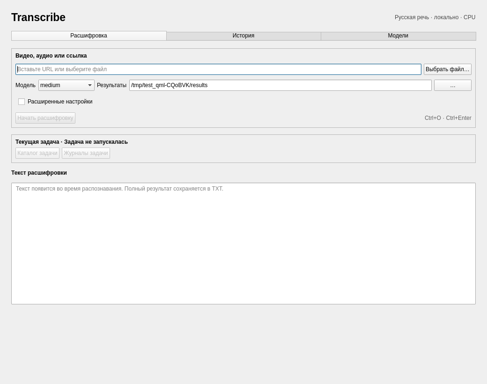
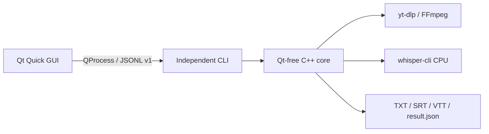

<p align="center"></p>

# Transcribe

Local transcription of Russian lectures, audio and video on your **CPU**.
Use the native desktop GUI or the independent CLI to produce TXT, SRT and VTT.
Recognition runs locally through whisper.cpp; URL downloads use yt-dlp and media
conversion uses FFmpeg. The application interface and recognition language are Russian.

**C++23 · Qt Quick / QML · CMake · Linux / Windows · CPU-only**

[Download v0.4.0](https://github.com/khdobromir/lecture-transcriber/releases/tag/v0.4.0)
· [Changelog](CHANGELOG.md) · [Documentation](docs/windows-gui.md)
· [Contributing](CONTRIBUTING.md)

## Demo



Actual Qt Quick interface, captured by the isolated QML startup test with empty
models and temporary settings; this is not a recognition or performance result.

```sh
transcribe --version
# transcribe 0.4.0
transcribe --model small "lecture.wav"
transcribe --chunks 10 --jobs 2 --threads 3 --out "results" "lecture.mp4"
```

The last two examples require installed tools/models and your own media file.
[Recorded CLI help session](docs/assets/cli-session.txt).

## Features

- Local audio/video files and one URL supported by the installed yt-dlp.
- Live partial text, progress and estimated remaining recognition time.
- TXT, SRT and VTT exports with one result directory per run.
- Cancellation, preserved partial results and per-tool diagnostic logs.
- Model download/import with SHA-256 verification; small, medium and turbo presets.
- Downloaded-media cache with a size limit; explicit CPU threads/chunks/jobs.
- GUI history and separate model/data storage across application upgrades.

## Quick Start

1. Download the application and its checksum from [Releases](https://github.com/khdobromir/lecture-transcriber/releases/tag/v0.4.0).
2. Linux: make the AppImage executable and launch it. Windows: extract the **whole**
   ZIP and launch `bin/transcribe-gui.exe`.
3. Open **Модели** (Models), download or import a recognition model and Silero VAD.
4. Select a local file on **Расшифровка** (Transcription), choose an output directory and start.
5. Open the result directory; transcripts are under `transcripts/` and logs under `logs/`.

```sh
chmod +x Transcribe-0.4.0-linux-x86_64.AppImage
./Transcribe-0.4.0-linux-x86_64.AppImage
# If FUSE is unavailable:
./Transcribe-0.4.0-linux-x86_64.AppImage --appimage-extract-and-run
```

Models are not bundled. For a fully offline first run, import them beforehand.
URL downloads and downloading models need network access; local recognition does not.

## Installation

| Route | Supported target | Application dependencies |
|---|---|---|
| Linux AppImage | x86_64, glibc 2.39+; Ubuntu 24.04+, Debian 13, Arch | Qt, CPU Whisper, FFmpeg and standalone yt-dlp included |
| Windows ZIP | Windows 11 x64 | Qt, CPU Whisper, FFmpeg, standalone yt-dlp and runtime included |
| Linux source installer | C++23 toolchain and CLI prerequisites | Builds the CLI and CPU engine; uses system FFmpeg/yt-dlp |
| Developer build | Linux/Windows; optional Qt GUI | [Build requirements and commands](docs/windows-gui.md) |

No separate Python, Qt SDK or compiler is needed to run the binary packages.
Models, settings and results are user data outside the packages. GPU acceleration,
macOS, ARM and musl/Alpine are outside the current package support.

For the Linux CLI source installer, after installing the prerequisites:

```sh
git clone https://github.com/khdobromir/lecture-transcriber.git
cd lecture-transcriber
bash install.sh small
export PATH="$HOME/.local/bin:$PATH"
transcribe --help
```

Run the installer as a regular user. [Linux portable details](docs/linux-portable.md)
and [GUI/Windows instructions](docs/windows-gui.md) explain the separate routes.

## Usage

```sh
transcribe --model medium --prompt "Tensor, covariant, basis" "lecture.wav"
transcribe --no-progress --out "results" "https://example.org/your-video"
```

The URL is a placeholder; extractor availability depends on the site and yt-dlp.
One chunk is the default. Increasing jobs starts more model-owning processes and
uses more memory. Live TXT preserves recording order; final subtitles appear
when export completes. Use GUI Cancel or CLI Ctrl+C rather than killing the process.

Use `transcribe --help` for all flags. The GUI exposes task, history and model
management; machine consumers use the [JSONL v1 contract](docs/protocol-v1.md).

## How it works



The GUI owns presentation and background model/history operations. A backend
process runs one transcription task and supervises its external tools.

## Engineering Highlights

- **Native process lifecycle:** [Linux supervisor](src/process_guard_linux.cpp)
  and [Windows Job Objects / handle policy](src/process_windows.cpp).
- **Checked completion:** [typed protocol validation](src/protocol.cpp) and
  [GUI process/result confirmation](gui/backend.cpp), with [contract tests](tests/test_protocol.cpp).
- **Owned asynchronous work:** [model verification, import and publication](gui/models.cpp)
  use worker cancellation and locks, with [GUI regressions](tests/test_gui.cpp).
- **Export correctness:** [audio pipeline](src/audio.cpp), [timestamp bounds](tests/test_export_bounds.cpp)
  and [real FFmpeg split tests](tests/test_split.cpp).
- **Distribution checks:** [Linux AppImage builder](scripts/package-linux.py),
  [Windows ZIP builder](scripts/package-windows.ps1), exact input hashes,
  retained source materials and clean-environment package smoke.

ASR and model development belong to upstream Whisper/whisper.cpp; Transcribe's
contribution is native integration, lifecycle, validation and the application.

## Performance and limitations

Speed and RAM depend on CPU, model, duration and parallelism. Medium may run slower
than real time. ASR mistakes, especially terms, names and formulas, need review.
ETA is approximate; partial text is not a completed result. Interrupted tasks
can be retried but do not resume recognition at the previous position.

[One historical 0.3.0 lecture measurement](docs/lecture-validation-2026-10-03.md)
is hardware/input specific; it is neither a current 0.4.0 benchmark nor a WER study.
Do not publish cookies, private URLs, recordings or unredacted diagnostic logs.

## Development and testing

```sh
cmake -S . -B build -DCMAKE_BUILD_TYPE=Debug -DTRANSCRIBE_WARNINGS_AS_ERRORS=ON
cmake --build build --parallel 2
ctest --test-dir build --output-on-failure
```

CLI: CMake 3.20+ and C++23. GUI: CMake 3.24+, Qt 6.8+ and
`-DTRANSCRIBE_BUILD_GUI=ON`. Tests need Python 3.11+ and Linux suites need FFmpeg.
Use `-DBUILD_TESTING=OFF` for an application-only build.

[CI](.github/workflows/ci.yml) covers Linux GCC/Clang, Windows MSVC, Qt,
static analysis and ASan/UBSan. [Real Whisper smoke](.github/workflows/real-smoke.yml)
and [portable package checks](.github/workflows/linux-portable.yml) are separate.
[Published 0.4.0 validation](docs/release-validation-v0.4.0.md) describes that release,
not every later source revision. See [CONTRIBUTING](CONTRIBUTING.md) for developer checks.

## Contributing

Report the version, OS, installation route and a minimal reproducible example.
Read [CONTRIBUTING.md](CONTRIBUTING.md) before changing process or packaging contracts.
The [approved modernization roadmap](docs/development-roadmap.md) tracks current work.

## License

Transcribe's own code is [MIT](LICENSE). Bundled libraries, tools and downloaded
models retain their own terms; see [THIRD_PARTY.md](THIRD_PARTY.md).
