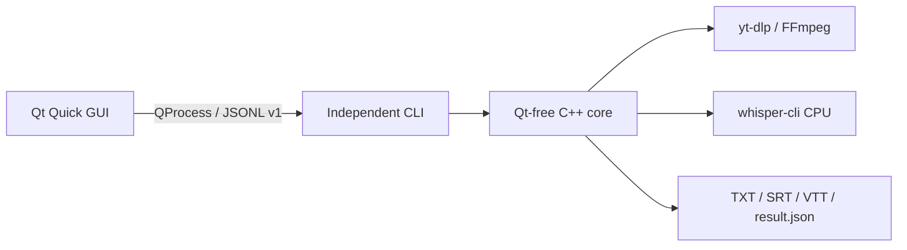

<p align="center"></p>

<h1 align="center">Transcribe</h1>

<p align="center"><strong>Русский</strong> · <a href="README.en.md">English</a></p>

Локальная транскрипция русскоязычных лекций, аудио и видео на **CPU**.
Нативный графический интерфейс и независимый CLI создают TXT, SRT и VTT.
Распознавание выполняется локально через whisper.cpp, загрузка по URL — через
yt-dlp, обработка медиа — через FFmpeg. В текущих исходниках GUI поддерживает
русский и английский языки, автоматический выбор и переключение без перезапуска.
Язык распознавания остаётся русским; консольный интерфейс CLI также остаётся
русским. Опубликованные пакеты v0.4.1 содержат прежний GUI только на русском;
для локализованного интерфейса пока требуется сборка текущих исходников.

**C++23 · Qt Quick / QML · CMake · Linux / Windows · CPU-only**

[Скачать v0.4.1](https://github.com/khdobromir/lecture-transcriber/releases/tag/v0.4.1)
· [История изменений](CHANGELOG.md) · [Документация](docs/README.md)
· [Участие в разработке](CONTRIBUTING.md)

[Описание v0.4.1](docs/releases/v0.4.1/notes.md) и
[результаты проверок](docs/releases/v0.4.1/validation.md).

## Демонстрация


Реальный Qt Quick интерфейс, снятый изолированным тестом запуска QML с пустым
каталогом моделей и временными настройками. Это не результат распознавания
или измерения производительности; снимок показывает предыдущий русский интерфейс.

```sh
transcribe --version
# transcribe 0.4.1 (версия текущих исходников)
transcribe --model small "lecture.wav"
transcribe --chunks 10 --jobs 2 --threads 3 --out "results" "lecture.mp4"
```

Для двух последних примеров нужны установленные инструменты, модели и собственная запись.
[Записанный вывод справки CLI](docs/assets/cli-session.txt).

## Возможности

- Локальные аудио- и видеофайлы либо один URL, поддерживаемый установленным yt-dlp.
- Частичный текст во время распознавания, прогресс и приблизительное оставшееся время.
- Экспорт TXT, SRT и VTT с отдельным каталогом результатов каждого запуска.
- Отмена, сохранение частичных результатов и отдельные диагностические журналы инструментов.
- Загрузка и импорт моделей с проверкой SHA-256; пресеты small, medium и turbo.
- Кэш скачанного медиа с ограничением размера; настройка потоков CPU, частей и работников.
- История GUI; модели и пользовательские данные сохраняются отдельно при обновлении приложения.
- Русский и английский GUI с сохранением выбора языка и немедленным переключением в текущих исходниках.

## Быстрый старт

[Краткая инструкция на русском](docs/user/ru/quick-start.md) · [English guide](docs/user/quick-start.md)

1. Скачайте приложение из [Releases](https://github.com/khdobromir/lecture-transcriber/releases/latest) и сравните SHA-256 с digest этого файла.
2. Linux: разрешите запуск AppImage и откройте его. Windows: распакуйте **весь** ZIP и запустите `bin/transcribe-gui.exe`.
3. Откройте **Модели / Models**, скачайте или импортируйте модель распознавания и Silero VAD.
4. На вкладке **Расшифровка / Transcription** выберите локальный файл, каталог результатов и запустите обработку.
5. Откройте каталог результата: расшифровки находятся в `transcripts/`, журналы — в `logs/`.

```sh
chmod +x Transcribe-X.Y.Z-linux-x86_64.AppImage
./Transcribe-X.Y.Z-linux-x86_64.AppImage
# Если FUSE недоступен:
./Transcribe-X.Y.Z-linux-x86_64.AppImage --appimage-extract-and-run
```

Замените `X.Y.Z` версией скачанного файла. Начиная с 0.4.1 отдельные `.sha256`
не публикуются: digests загруженных файлов доступны непосредственно в GitHub Releases.

Модели не входят в пакет. Для первого запуска полностью без интернета импортируйте
их заранее. Загрузка по URL и скачивание моделей требуют сети; локальное распознавание — нет.

## Установка

| Способ | Поддерживаемая платформа | Зависимости приложения |
|---|---|---|
| Linux AppImage | x86_64, glibc 2.39+; Ubuntu 24.04+, Debian 13, Arch | Qt, CPU Whisper, FFmpeg и standalone yt-dlp включены |
| Windows ZIP | Windows 11 x64 | Qt, CPU Whisper, FFmpeg, standalone yt-dlp и runtime включены |
| Установщик CLI из исходников для Linux | Инструменты C++23 и зависимости CLI | Собирает CLI и CPU-движок; использует системные FFmpeg/yt-dlp |
| Сборка разработчика | Linux/Windows; GUI на Qt опционален | [Требования и команды сборки](docs/build/from-source.md) |

Для запуска бинарных пакетов не нужны отдельные Python, Qt SDK или компилятор.
Модели, настройки и результаты хранятся вне пакетов. GPU, macOS, ARM и musl/Alpine
не входят в текущую поддержку пакетов.

Для установки CLI из исходников в Linux после установки зависимостей:

```sh
git clone https://github.com/khdobromir/lecture-transcriber.git
cd lecture-transcriber
bash install.sh small
export PATH="$HOME/.local/bin:$PATH"
transcribe --help
```

Запускайте установщик от обычного пользователя. [Описание Linux AppImage](docs/build/linux-portable.md)
и [руководство пользователя](docs/user/ru/guide.md) объясняют различия способов установки.

## Использование

```sh
transcribe --model medium --prompt "Tensor, covariant, basis" "lecture.wav"
transcribe --no-progress --out "results" "https://example.org/your-video"
```

URL приведён для примера; доступность извлечения зависит от сайта и yt-dlp.
Системная конфигурация yt-dlp игнорируется. Начиная с 0.4.1 отключены и каталоги
плагинов; опубликованная v0.4.0 не изменяется. Обновлённой установке из исходников
нужна поддержка `--no-plugin-dirs`, доступная в закреплённой версии 2026.08.19.
Пользовательские плагины извлечения не поддерживаются.

По умолчанию используется одна часть. Большее число работников запускает больше
процессов с собственными моделями и требует больше памяти. Частичный TXT сохраняет
порядок записи; итоговые субтитры появляются после экспорта. Для остановки используйте
кнопку отмены GUI или Ctrl+C в CLI.

Все параметры доступны через `transcribe --help` и в [справочнике CLI](docs/user/cli.md).
GUI управляет задачей, историей и моделями; для интеграций предусмотрен
[контракт JSONL v1](docs/architecture/protocol-v1.md).

## Как это устроено



GUI отвечает за отображение и фоновые операции с моделями и историей.
Отдельный backend-процесс выполняет одну задачу и управляет внешними инструментами.
[Архитектура и решения](docs/architecture/overview.md) описывают владение ресурсами,
поток обработки медиа и границу завершения/отмены.

## Инженерные решения

- **Жизненный цикл процессов:** [Linux supervisor](src/process_guard_linux.cpp) и [Windows Job Objects / политика дескрипторов](src/process_windows.cpp).
- **Подтверждённое завершение:** [типизированная проверка протокола](src/protocol.cpp), [проверка процесса и результатов в GUI](gui/backend.cpp), [контрактные тесты](tests/test_protocol.cpp).
- **Владение фоновой работой:** [проверка, импорт и публикация моделей](gui/models.cpp) с отменой и блокировками; [регрессионные тесты GUI](tests/test_gui.cpp).
- **Корректность экспорта:** [аудиопайплайн](src/audio.cpp), [границы временных меток](tests/test_export_bounds.cpp), [реальная нарезка через FFmpeg](tests/test_split.cpp).
- **Проверки распространения:** [сборщик Linux AppImage](scripts/package-linux.py), [сборщик Windows ZIP](scripts/package-windows.ps1), точные хеши входов сборки, сохранённые исходные материалы и smoke-проверки пакетов в чистом окружении.

Модели и ASR разработаны проектами Whisper/whisper.cpp. Вклад Transcribe — нативная
интеграция, управление жизненным циклом, верификация и само приложение.

## Производительность и ограничения

Скорость и расход RAM зависят от CPU, модели, длительности записи и параллелизма.
Medium может работать медленнее реального времени. Ошибки ASR, особенно в терминах,
именах и формулах, требуют проверки. ETA приблизительна; частичный текст не является
завершённым результатом. Повтор прерванной задачи начинает распознавание заново.

[Исторические измерения и методика](docs/benchmarks/README.md) относятся к конкретным
записям и оборудованию; это не актуальные бенчмарки 0.4.0 и не исследование WER.
Не публикуйте cookies, приватные URL, записи и диагностические журналы без удаления личных данных.

## Разработка и тестирование

```sh
cmake --preset linux-cli-debug
cmake --build --preset linux-cli-debug --parallel 2
ctest --preset linux-cli-debug
```

CLI: CMake 3.20+ и C++23. GUI: CMake 3.24+, Qt 6.8+ с LinguistTools и
`-DTRANSCRIBE_BUILD_GUI=ON`. Для тестов нужен Python 3.11+, для Linux-наборов — FFmpeg.
Для сборки только приложения используйте `-DBUILD_TESTING=OFF`.

[CI](.github/workflows/ci.yml) проверяет Linux GCC/Clang, Windows MSVC, Qt,
статический анализ и ASan/UBSan. [Real Whisper smoke](.github/workflows/real-smoke.yml)
и [проверки переносимых пакетов](.github/workflows/linux-portable.yml) выполняются отдельно.
[Проверки опубликованной 0.4.0](docs/releases/v0.4.0/validation.md) относятся к тому релизу,
а не ко всем последующим изменениям. [Руководство разработчика](docs/developer/getting-started.md)
и [руководство по тестированию](docs/testing/README.md) содержат карту исходников и уровни проверки.

## Участие в разработке

При сообщении об ошибке укажите версию, ОС, способ установки и минимальный пример.
Перед изменением контрактов процессов или упаковки прочтите [CONTRIBUTING.md](CONTRIBUTING.md).
Для уязвимостей используйте [конфиденциальный канал](SECURITY.md).
[Утверждённая дорожная карта](docs/development-roadmap.md) и
[отчёт о реализации](docs/development-report.md) описывают завершённую модернизацию.

## Лицензия

Собственный код Transcribe распространяется под [MIT](LICENSE). Библиотеки,
инструменты и скачиваемые модели сохраняют собственные условия;
см. [THIRD_PARTY.md](THIRD_PARTY.md).
