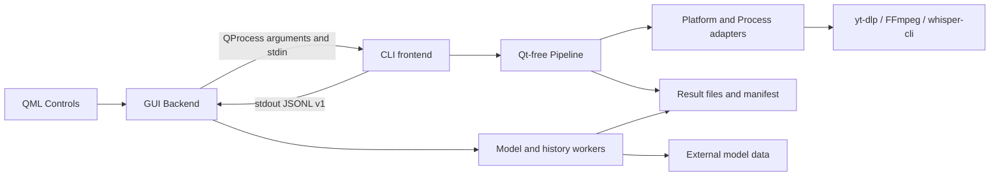
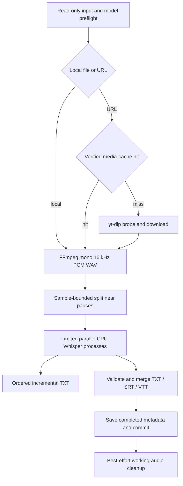
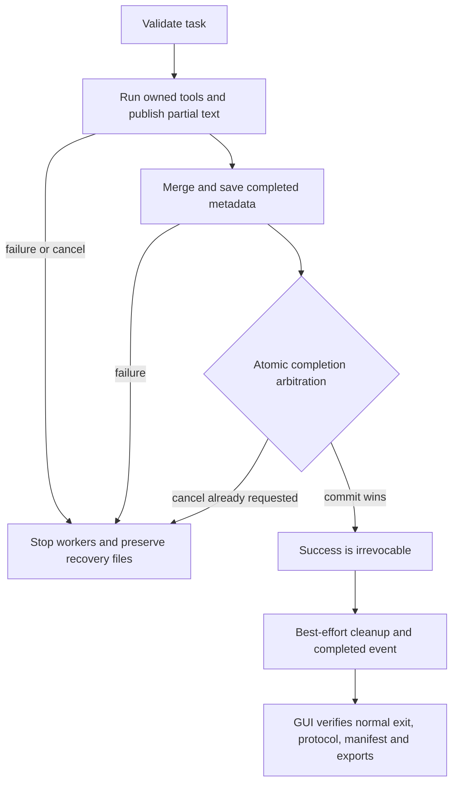

# Architecture

[Source map](../developer/getting-started.md) · [Protocol v1](protocol-v1.md)
· [GUI states/workers](gui-states.md)

The core and standalone CLI are native C++23. Qt Quick is a separate frontend;
whisper.cpp is an external CPU engine, not code/model developed by this project.
This document describes the existing boundaries rather than a new framework.

## Components

[Root CMake](../../CMakeLists.txt) builds `transcribe_core` and `transcribe`;
[GUI CMake](../../gui/CMakeLists.txt) adds `transcribe_gui_logic` and
`transcribe-gui` only when requested. Platform implementations are selected at
configure. [tests/CMakeLists.txt](../../tests/CMakeLists.txt) owns core/CLI test
registration; Qt tests remain beside GUI build requirements. Existing root/config
binary paths are deliberate interfaces for CI/package harnesses.

[Pipeline](../../src/pipeline.cpp) owns task orchestration and emits typed events
through `EventSink`. [main.cpp](../../src/main.cpp) owns terminal presentation or
machine serialization. [Backend](../../gui/backend.cpp) owns QProcess, event
validation, GUI states and independent completion checks. It can select history
while a task runs without changing the task's result identity.

## Media flow

[MediaCache](../../src/media.cpp) is a local downloaded-media cache, not a model
cache or ASR-resume mechanism. Managed entries are checked and cache locks are
released before recognition. Cache failures warn/fall back where safe; invalid
media preparation can invalidate an entry. The original local input is not
cleanup-owned. URL naming may move a temporary result root once; protocol tracks
that transition explicitly.

[audio.cpp](../../src/audio.cpp) checks WAV/sample bounds and merge offsets.
Requested chunks/jobs are explicit; one chunk is default. Each worker has its
own engine/model memory. Published TXT follows recording order even when later
workers finish first. [Export tests](../../tests/test_export_bounds.cpp) cover
Whisper's 20 ms quantization, clipping a crossing segment with warning and
rejecting wholly external timestamps. Progress/ETA are observations, not a commit.

## Task, cancellation and completion

[CancellationToken](../../src/cancellation.cpp) arbitrates cancellation against
commit atomically. Before commit, cancellation/errors stop all workers, flush
available ordered TXT and preserve work/status. After commit, cleanup/notification
failures cannot revoke saved success. A GUI communication failure can still mark
the current interaction failed; the saved result remains discoverable separately.
The GUI's exact transitions are in [gui-states](gui-states.md), not this simplified
core lifecycle diagram. `result.json` is atomically replaced, but all exports and
metadata together are not one filesystem transaction.

## Resource and error ownership

[Process](../../src/process.hpp) is noncopyable and owns native process state,
two drained output channels and its diagnostic log. Linux uses process groups,
poll and an [independent supervisor](../../src/process_guard_linux.cpp) whose
CLOEXEC lifetime pipe detects CLI death and reaps/kills managed descendants.
Fork-child work is limited to preallocated state/syscalls before exec. Deliberate
escape from the managed group is outside this contract. Windows
[starts suspended](../../src/process_windows.cpp), restricts inherited handles,
joins a kill-on-close Job Object, then resumes. RAII handles and destructors
provide cleanup when task control unwinds; normal cancellation still drains output.

External tools receive argument vectors rather than an application-built shell
command. Windows applies its command-line quoting/size checks; URLs follow `--`
in yt-dlp calls. Config/cache/plugin directories are disabled there. This isolates
ambient behavior; it does not make arbitrary third-party tool binaries trusted.
Bundles resolve local tools and reject incomplete marked distributions. See
[CPU/bundle ADR](adr/0002-cpu-runtime-and-bundles.md).

`ProcessError` carries exit status; pipeline translates exceptions into
`RunResult`, failed/interrupted metadata and terminal events while preserving
the original failure if secondary reporting fails. GUI parsing has bounded lines,
bytes and events per turn. Stale callbacks cannot mutate a newer selection/task.
Qt workers own snapshots/cancellation and are joined on teardown, with exceptions
unwrapped for display. [Protocol tests](../../tests/test_protocol.cpp),
[controller tests](../../tests/test_gui.cpp), [independent pipeline fixtures](../../tests/test_pipeline.cpp)
and [actual GUI/CLI integration](../../tests/test_gui_integration.cpp) make these
boundaries inspectable. None establishes immunity to OS shutdown or forced kill.

## Decisions

- [ADR 0001: CLI process boundary and one backend task](adr/0001-cli-process-boundary.md).
- [ADR 0002: CPU runtime, external tools and separate model/bundle data](adr/0002-cpu-runtime-and-bundles.md).
